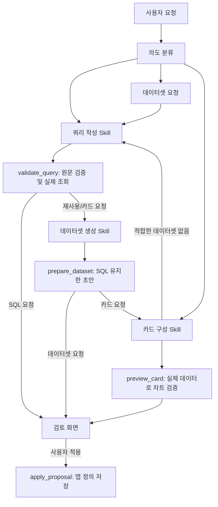

# 채팅 Skill / Tool 구조

2026-10-20 구현. 시맨틱 용어·지표 저장소는 별도 채팅에서 진행하며, 이 문서는 채팅 실행 흐름을 설명합니다.

## 역할

| 구성 | 코드 | 역할 |
|---|---|---|
| 쿼리 작성 Skill | `backend/app/chat_skills/query.md` | 자연어 조건을 SQL 원문 또는 단일 테이블 피벗 설정으로 작성 |
| 데이터셋 생성 Skill | `backend/app/chat_skills/dataset.md` | 검증된 SQL을 재사용할 데이터셋 이름·설명 구성 |
| 카드 구성 Skill | `backend/app/chat_skills/card.md` | 기존/초안 데이터셋의 실제 컬럼으로 CardSpec 작성 |
| 요청 분류·연쇄 처리 | `backend/app/chat_workflow.py` | 의도 분류, 의존 작업 실행, 확인 질문, 제한된 재시도 |
| 검증·실행·저장 Tool | `backend/app/chat_tools.py` | 읽기 전용 조회, 카드 미리보기, 원자적 적용 |
| 입출력 계약 | `backend/app/chat_contracts.py` | 단계별 JSON 스키마와 적용 요청 검증 |
| 내부 LLM 어댑터·API | `backend/app/assistant.py` | 사내 호환 서버 연결, SSE, 인증된 검토·적용 API |

Skill은 이 앱의 서버가 불러오는 버전 관리 가능한 지침 파일입니다. Codex 플러그인을 설치하거나 별도 모델 세 개를 실행하는 구조가 아닙니다.

## 연쇄 처리

각 Skill은 모호한 요청에 `clarification`을 반환할 수 있습니다. UI는 질문과 선택지를 표시하며, 사용자 답변은 이전 대화와 함께 다음 요청에 전달됩니다.

한 단계에서 잘못된 JSON·SQL·컬럼·카드 설정이 나오면 검증 피드백으로 한 번만 수정 요청합니다. 카드의 새 데이터셋 요청은 한 번만 허용하며, 최대 다섯 단계(분류→카드→쿼리→데이터셋→카드), 단계당 최대 두 번의 모델 호출입니다. 무제한 에이전트 루프는 없습니다.

## Tool 계약과 실행

- `validate_query(source_id, sql, name, project_id, pivot?)`: 기존 읽기 전용 SQL 검사와 `preview_dataset`을 사용합니다. SQL 원문은 그대로 실행하며 실제 DB에서 얻은 컬럼 타입과 최대 30행을 반환합니다. AI가 단일 원천의 마지막 값 피벗 설정을 반환하면 간편 작성기와 동일한 컴파일러로 SQL을 생성하고, 검증된 설정과 SQL을 함께 반환합니다.
- `prepare_dataset(validated, name)`: 모델이 이미 검증된 SQL을 다시 작성하지 않도록 원문과 출력 컬럼을 그대로 사용합니다. 이 단계는 저장하지 않습니다.
- `preview_card(card, project_id, definition?, validated?)`: 저장된 데이터셋 또는 저장 전 정의로 공통 `chart_query` 엔진을 사용합니다. 초안 조회는 기존 카드 캐시를 재사용하거나 오염시키지 않습니다.
- `apply_proposal(body, user)`: 사용자 적용 요청에서만 실행합니다. 새 데이터셋과 카드가 함께 있으면 하나의 메타데이터 DB 트랜잭션에서 저장합니다. 원천 DB에는 쓰지 않습니다.

카드는 SQL 결과에 별도의 축·집계·필터 처리를 하는 기존 카드 엔진을 사용합니다. 쿼리 Skill이 작성한 원문 조회와 카드 집계는 구분됩니다. 같은 비율을 다시 평균 내는 등의 업무 의미는 지침과 추후 시맨틱 지표 정의에서 함께 검토해야 합니다.

## API / UI

- `POST /api/chat`: `status`, `clarification`, `proposal`, `analysis_proposal`, `error`, `done` SSE 이벤트. 저장 대화는 `conversation` 식별자도 전달합니다. 이전 `analysis` 응답 이력은 계속 조회합니다.
- `proposal`: `kind=query|dataset|card`, `dataset?`, `card?`, `query_result?`, `card_result?`, `proposal_id`, `project_id`, `workspace_token`, `steps`.
- `POST /api/chat/preview`: 수정한 제안을 다시 검증·조회합니다. 저장하지 않습니다.
- `POST /api/chat/apply`: 검토한 제안을 저장합니다. 카드에는 대상 대시보드 ID/버전이 필요합니다.
- 세 경로 모두 편집자 이상 권한이 필요합니다. 활성 DB 토큰·프로젝트·숨긴 테이블·실제 컬럼 검증을 유지합니다.
- 검토 화면에서 SQL·데이터셋 이름·카드 제목·차트·축·집계를 수정할 수 있습니다. 수정 후에는 미리보기를 다시 통과해야 적용할 수 있습니다.
- 대시보드 버전 충돌 시 전체 작업이 취소됩니다. 새 데이터셋만 남지 않습니다.
- 적용 요청의 고유 ID와 감사 기록으로 같은 요청 재시도 시 중복 저장을 방지합니다. 적용된 채팅 제안의 버튼도 비활성화합니다.
- 후속 대화에는 제안 SQL/CardSpec을 포함하되 조회 결과 행은 모델로 재전송하지 않습니다.

## 승인 지식의 채팅 연결

SQL·데이터셋·카드로 분류한 다음 기존 의미 지식 검색을 호출합니다. 현재 사용자·DB·프로젝트와
선택 데이터셋을 기준으로 승인된 정의와 유효한 승인 매핑만 모델에 제공합니다. 일치하는 지식이
없으면 기존 일반 SQL 흐름을 유지하며 업무 의미를 임의로 확정하지 않도록 안내합니다.

동명 용어가 충돌하면 조회 SQL을 생성·실행하기 전에 선택지를 표시합니다. 선택은 서버가 이전
컨텍스트에 실제로 제시한 정의만 허용합니다. 응답의 **AI에 제공한 승인 지식**은 서버가 기록한
정의·매핑 버전입니다. 모델이 실제로 모든 정의를 올바르게 적용했다는 보증은 아닙니다.

미리보기·적용 전에는 근거를 다시 검사합니다. 철회되거나 원천 매핑이 달라지면 다시 요청해야
합니다. 대화 복원에서도 사용할 수 없게 된 지식에 의존하는 이전 SQL·설명을 숨깁니다.
입출력 모델은 `backend/app/chat_knowledge.py`, 생성 화면 타입은 `chatKnowledge.generated.ts`입니다.
`validation/generate_chat_feature_contracts.py --check`로 동기화를 확인합니다.

### AI 피벗과 간편 작성기

- 쿼리 Skill의 응답은 `sql` 또는 `pivot` 중 하나만 포함합니다. 단일 원천의 마지막 값 피벗은 행·열·값·시간·동일 시각 기준, 열 항목과 원천 필터를 구조화한 `pivot`으로 작성합니다. JOIN 후 피벗이나 설정 범위 밖의 계산은 `sql`을 사용합니다.
- 피벗 SQL은 앱 공통 컴파일러에서 생성하므로 간편 작성기와 별도 구현이 아닙니다. 검토 화면과 SQL 편집기에 표시되는 SQL을 그대로 조회합니다. 모델이 SQL과 설정을 독립적으로 작성해 서로 달라지는 경로를 허용하지 않습니다.
- AI 제안의 간편 작성기에서 피벗 설정과 원천 필터를 수정할 수 있습니다. 변경된 설정을 SQL로 다시 생성하고 미리보기 검증을 통과해야 저장합니다. SQL 탭을 직접 수정하면 피벗 설정을 분리합니다.
- 저장한 데이터셋을 쿼리 관리에서 다시 열면 피벗 설정을 복원합니다. 데이터셋 생성 Skill, 카드의 새 데이터셋 의존 작업, 미리보기·저장 경로에서 설정을 유지합니다. 적용 전에도 SQL과 설정의 일치를 재검증합니다.
- 기존 raw SQL 데이터셋을 임의로 피벗 설정으로 역변환하지 않습니다. 기존 단일 테이블 SQL을 간편 피벗으로 바꾸려면 AI에 변환을 요청할 수 있으며, 조건을 보존할 수 있을 때 설정을 새로 구성합니다. JOIN이 포함된 쿼리는 계속 SQL 편집기로 다룹니다.

## 모델 연결

`/chat/completions` 호환 서버의 JSON 응답을 앱에서 검증하는 어댑터입니다. 공인·사설 주소 여부로 연결을 제한하지 않고 관리자가 설정한 endpoint와 모델을 사용합니다. 모델의 네이티브 Tool Calling 지원을 전제하지 않습니다. 모델이 임의 Tool 이름으로 실행하거나 저장하도록 하지 않고, 서버의 정해진 흐름이 검증된 단계에 맞는 Tool만 호출합니다.

Endpoint와 모델은 공통 `.env`의 `LLM_BASE_URL`, `LLM_MODEL`을 사용합니다. API 키는 프로필의 **LLM API 키 설정**에서 사용자별로 관리하며, 채팅 요청의 인증된 사용자 ID로 조회합니다. 모든 Skill 호출은 그 요청자의 키를 사용합니다. 공통 `LLM_API_KEY` 대체 경로는 없습니다.

- `GET /api/llm/status`: 공통 설정과 본인 키 등록 여부, 마지막 연결 확인 상태만 반환합니다.
- `PUT /api/llm/credential`: 본인 키 등록·교체. 사용자 ID는 요청에서 받지 않습니다.
- `DELETE /api/llm/credential`: 본인 키만 삭제합니다.
- `POST /api/llm/check`: 저장된 키로 공통 모델에 짧은 테스트 요청을 보냅니다.

연결 확인 결과는 키 revision과 endpoint·모델 조합에 연결됩니다. 교체·삭제 중 도착한 이전 확인 결과는 적용하지 않고, 서버 설정이 달라지면 미확인 상태로 표시합니다. 연결 확인 실패 시 upstream 응답 원문을 노출하지 않습니다. 개인 키 API는 활성 원천 DB·프로젝트와 무관하며 조회자도 사용할 수 있습니다. 채팅 편집 권한은 기존과 같습니다. 원문 키는 브라우저 저장소·응답·감사 기록에 남기지 않고, 서버의 별도 암호화 키로 앱 DB에 저장합니다.

모델별 채팅 템플릿 호환성을 위해 지시·출력 스키마·등록 문맥은 하나의 system 메시지로 전달합니다. 요청 분류 단계에는 전체 테이블 카탈로그를 보내지 않습니다. 각 호출은 원래 사용자 요청과 현재 Skill의 출력 형식을 함께 명시하며, 검증 재시도에서도 원래 요청을 다시 전달합니다. 내부 JSON 형식 오류를 사용자에게 업무 확인 질문으로 돌리지 않도록 구분합니다. 형식·SQL·카드 검증과 단계당 한 번의 수정 재시도 제한은 유지합니다.

원천 접속 정보는 모델에 보내지 않습니다. LLM 응답 형식/업무 정확도는 실제 사내 모델로 평가해야 합니다. 현재 로컬 검증은 모의 LLM 응답과 실제 PostgreSQL 조회를 결합했습니다.

## 시맨틱 계층 연결 지점

`chat_tools.knowledge_context(sources, question=..., project_id=...)`를 공유 지식 조회 확장 지점으로 둡니다. 현재는 보이는 원천 간 관계만 참고 정보로 제공합니다. 향후 별도 시맨틱 저장소에서 현재 DB·프로젝트·질문과 관련된 용어, 지표, 근거, 검증된 예제를 가져와 반환할 수 있습니다.

이 지식은 SQL 작성 근거이며 SQL 실행 시 숨겨진 JOIN/WHERE를 삽입하는 규칙이 아닙니다. Skill 프롬프트의 "JOIN은 사전 등록 관계만 사용" 제약도 제거했습니다.
