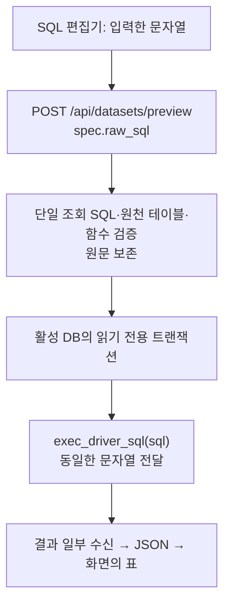

# SQL 편집기에서 PostgreSQL 조회까지

2026-10-25 프로젝트 경계 보강. 아래 기존 실행 설명에서 원문 그대로 실행하는 경로는 전체 프로젝트에 해당합니다.

SQL 편집기와 저장본의 원문은 유지합니다. 전체 프로젝트에서는 원문을 그대로 실행합니다. 프로젝트를 선택한 조회에서는 `dataset_scope.scoped_sql`이 모든 실제 테이블 참조를 프로젝트 조건으로 감싼 실행용 SQL을 생성합니다. 따라서 WHERE 제거, OR TRUE, CTE, UNION, JOIN, 집계, 프로젝트 컬럼을 출력에서 제외하는 방식으로 다른 프로젝트의 측정값을 포함할 수 없습니다. 관리 프로젝트는 현재 `lot_cds`, 기존 프로젝트는 등록 `project_column`을 사용합니다. 프로젝트 범위를 확인할 수 없는 원천만 사용하는 쿼리는 실행을 거절합니다. 공통 참조 테이블은 프로젝트 원천과 연결해 사용할 수 있습니다.

데이터 관리 표, 미리보기/저장 검증, 카드·Python 카드, 평가 사례 분석이 같은 경계를 사용합니다. 캐시와 커서도 프로젝트 범위를 반영합니다. 원본 데이터·SQL·과거 버전을 덮어쓰지 않습니다. `GET /bootstrap`과 AI의 새 데이터셋 추천/재사용은 정확히 같은 프로젝트의 정의만 제공합니다. API의 `kind=source|derived`는 DB 원본과 추가 데이터셋을 구분하며, 이름이나 접두사만으로 원본을 판단하지 않습니다.

| 단계 | 실제 코드와 역할 |
|---|---|
| 요청 | `frontend/src/DatasetEditor.tsx`의 `runPreview()`가 `sqlDraft.ts`의 `editorRequest()`로 받은 `spec.raw_sql`을 전송 |
| API | `backend/app/main.py`의 `dataset_preview()`가 SQL 모드에서 `body.spec`을 그대로 전달 |
| 검증 | `query.py`의 `validate_dataset()`이 `direct_sql.py`의 파서로 검사하고 원문을 `direct_sql`에 보관 |
| DB 연결 | `query.py`의 `source_connection()`이 활성 DB에서 `SET TRANSACTION READ ONLY`, 조회 시간 제한, 읽기 전용 역할 검증을 적용 |
| 실행 | `query.py`의 `query_direct()`가 `connection.execution_options(stream_results=True, no_parameters=True).exec_driver_sql(sql)` 호출 |
| 결과 | 컬럼명·타입과 행을 JSON으로 전달하고, 편집기의 `DataGrid`에 표시 |

`exec_driver_sql()`은 SQLAlchemy의 SQL 표현식 컴파일을 거치지 않고 문자열을 DBAPI 커서에 전달합니다. 서버 커서를 통한 스트리밍은 결과를 나누어 읽기 위한 것으로, SELECT 본문에 숨겨진 WHERE·ORDER BY·LIMIT을 덧붙이지 않습니다.

편집기 미리보기는 현재 30행, 데이터 관리 표는 한 페이지에 100행을 표시합니다. 다음 페이지 존재 여부 확인을 위해 한 행 더 읽습니다. 이 제한은 결과 수신량에 대한 제한입니다. SQL 자체의 처리량을 제한하려면 편집기에 LIMIT이나 WHERE를 명시해야 하며, 집계·정렬은 필요한 입력 행을 처리할 수 있습니다.

**저장과 이후 조회**

- 저장은 미리보기로 검증한 `spec.raw_sql`을 `DatasetVersion`에 보관합니다. 저장 시 재검증을 위해 SQL을 한 번 더 실행합니다.
- 데이터 관리의 `/api/query`는 저장된 버전을 읽고 같은 SQL 실행 경로를 사용합니다. 기존 폼 형식의 데이터셋도 편집기에 내보내는 SQL을 생성해 동일한 경로로 실행하도록 수정했습니다.
- 데이터 관리의 컬럼 헤더 정렬은 브라우저가 현재 100행 안에서 처리합니다.
- 대시보드 카드의 COUNT·AVG·그룹·카드 필터는 별도의 분석 기능이므로 저장된 SQL 결과를 감싼 추가 쿼리가 실행됩니다. API에서 별도의 서버 정렬·필터를 명시한 경우에도 외부 쿼리를 구성합니다. SQL 편집기의 실행 버튼과 현재 데이터 관리 화면은 이 추가 조건을 보내지 않습니다.

**큰따옴표의 의미와 변경**

`s.lot_code`와 `"s"."lot_code"`는 PostgreSQL에서 같은 소문자 이름을 참조합니다. `"LotCode"`는 대소문자를 구분하는 이름이며 `'lot_code'`는 문자열 값입니다. 큰따옴표가 있다는 이유로 실행이 안 되는 것은 아닙니다.

기존 생성기가 모든 식별자에 `quoted=True`를 적용해 일반 이름에도 큰따옴표가 붙었습니다. 이제 생성되는 SQL은 `s.lot_code`처럼 표시합니다. 공백·대문자·예약어 등으로 필요한 따옴표는 보존합니다. 직접 입력한 SQL에 따옴표를 추가하거나 제거하지 않습니다.

SQL → 간편 작성기 → SQL 전환 중 폼 내용을 수정하지 않으면 원문과 주석·별칭·줄바꿈을 그대로 유지합니다. 실제 폼 편집이 있을 때만 새 SQL을 생성합니다. 과거 자동 생성 기본 쿼리는 정확히 기존 생성 형식과 일치하는 경우에만 새 버전을 만들고, 과거 버전과 사용자가 작성한 쿼리는 그대로 둡니다.

**검증 결과**

- Backend/demo 전체: **353 passed**.
- Frontend: **18 passed**, TypeScript 검사 및 프로덕션 빌드 통과.
- `backend/tests/test_direct_sql_api.py`는 SQLAlchemy의 `before_cursor_execute` 이벤트에서 드라이버로 전달되는 문장을 수집하여 편집기에 제출한 문자열과 정확히 같은지 확인합니다. 주석, 문자열의 콜론·퍼센트, 나머지 연산, 사용자 ORDER BY·LIMIT까지 포함합니다.
- 같은 테스트에서 기존 폼 데이터셋의 편집기 SQL과 `/api/query`의 실제 전달 SQL도 비교합니다.
- `frontend/tests/sqlDraft.test.mjs`는 탭 왕복으로 원문이 바뀌지 않고 실제 폼 편집이 있을 때만 SQL 생성 요청으로 전환되는지 확인합니다.
- 서버 재시작 후 실제 브라우저에서 일반 식별자 표시, SQL → 간편 작성기 → SQL의 원문 일치, 같은 SQL의 30행 조회를 확인했습니다. 검증용 쿼리는 저장하지 않았습니다.

[PostgreSQL 식별자·문자열 문법](https://www.postgresql.org/docs/current/sql-syntax-lexical.html), [SQLAlchemy exec_driver_sql](https://docs.sqlalchemy.org/en/20/core/connections.html#sqlalchemy.engine.Connection.exec_driver_sql)
