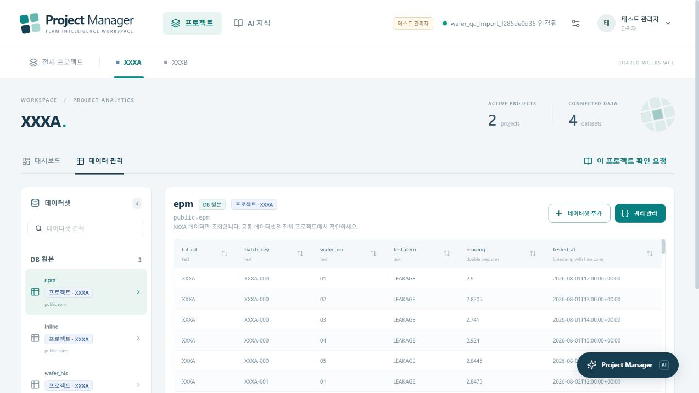
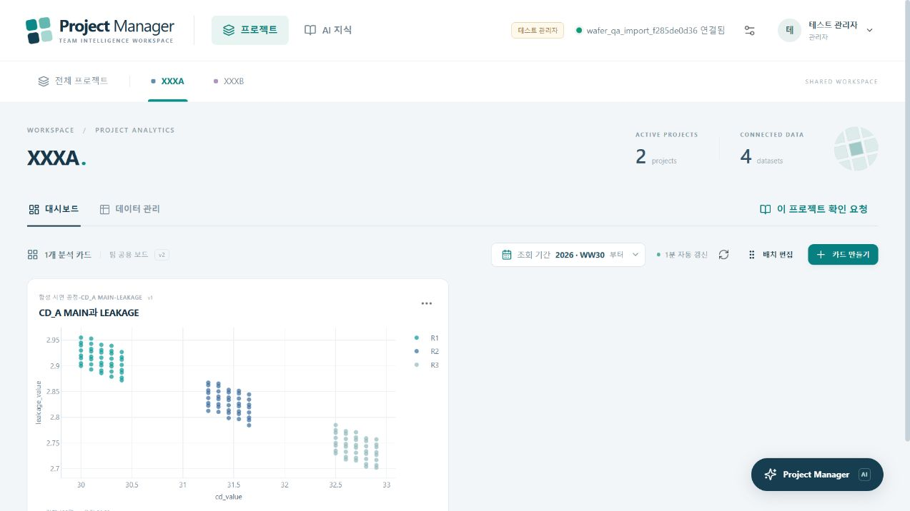

# 사내 파일 반입·시연 경로 검증

검증일: 2026-10-26. 실제 회사 데이터 대신 별도로 만든 합성 Parquet와 격리된 로컬 PostgreSQL을 사용했다. 기존 사용자의 앱 DB와 활성 원천은 전환하지 않았다.

## 반입과 프로젝트 구분

- `scripts/import_parquet_demo.py`가 세 폴더의 모든 part 파일을 새 DB로 가져오고, 읽기 전용 연결을 앱에 등록한다. `--activate`가 있을 때만 활성 연결을 바꾼다. 재등록은 `--register-only`로 수행한다.
- **`lot_cd` 이름과 원래 값을 그대로 보존한다.** 다른 컬럼도 자동으로 이름을 바꾸거나 의미를 추정하지 않는다. 프로젝트 관리에서 해당 `lot_cd` 값들을 연결한다.
- 공정 이력 240행, Inline 480행, EPM 240행을 각각 4·7·4개 파일로 가져와 모든 값을 비교했다. 문자열의 선행 0, 소수 정밀도, NULL, 한글, 불리언, 시간대가 있는 시각을 포함했다.
- 실제 저장은 `import_data`, 앱 조회는 같은 원본 컬럼·행을 노출하는 `public` 읽기 전용 뷰다. 세 원천만 목록에 노출되고 원본 저장 테이블이 중복 노출되지 않는다.
- 새 DB만 만들며 기존 DB 이름으로 재실행하면 중단한다. 파일별 스키마 차이·지원하지 않는 타입·시각 정밀도 손실은 무시하지 않는다. Spark INT96 형식의 무손실 시각 변환과 나노초 손실 차단을 단위 검사했다.

## 데모와 다른 컬럼으로 확인한 흐름

| 의미 | 검증한 실제 컬럼 |
| --- | --- |
| 프로젝트 | `lot_cd` 그대로 |
| 공정·Recipe·장비 | `process_stage`, `recipe_name`, `tool_code` |
| Inline 측정 항목 | `step_name` + `item_code` |
| Inline 값 | `reading` |
| EPM 항목·값 | `test_item`, `reading` |
| 연결 키 | `batch_key` + `wafer_no` |
| 공정·측정 시각 | `processed_at`, `measured_at`, `tested_at` |

1. XXXA·XXXB 프로젝트별 원천 조회 및 데이터셋 목록 분리를 검사했다. XXXA 조건을 SQL로 넓히려 해도 다른 프로젝트 행이 나오지 않는 기존 회귀 검사도 유지했다.
2. 공정 이력 → Inline CD_A/MAIN → EPM LEAKAGE를 연결한 XXXA 데이터셋을 만들고 120행을 확인했다. 동일한 MAIN을 가진 CD_B를 섞지 않았다. 공정/측정 순서 조건을 명시했다.
3. 기존 카드 API로 산점도를 저장했다. 실제 웹 화면에서 데이터셋 구분, 120행 차트, 기존 카드 편집기와 미리보기를 확인했다. 합성 데이터가 8월이므로 조회 시작을 WW30으로 설정했다. 오래된 회사 스냅샷도 카드의 조회 기간을 맞춰야 한다.
4. 확인 요청에 자연어로 컬럼 의미를 답변하고, 구조화 초안 검토·승인 후 실제 챗 컨텍스트에 해당 지식이 포함됨을 확인했다.
5. 앱의 실제 워커로 상관·그룹 비교·ML 회귀를 각각 120행에 실행했다. 상관 계산을 별도의 PostgreSQL 계산과 비교했고 실행 완료와 대화 복원을 확인했다.
6. ML 결과를 확인 요청으로 제출하고 승인해 평가 사례 v1로 축적했다. 해당 데이터셋에서 승인 사례가 다시 검색되고 웹 AI 지식 목록에 표시됨을 확인했다.

세부 결과는 로컬 `validation/company-demo-flow.json`에 있으며 실행 결과 파일은 Git에서 제외한다. 재현 스크립트: `company_demo_qa.py`, `verify_company_demo_flow.py`. 모델 해석·계획은 검증용 응답을 사용했고 계산과 DB·API·승인은 실제 코드로 수행했다.

## 발견한 문제와 수정

- 예전 PARA 도구는 고정 테이블·컬럼 구성을 요구한다. 현재 DB가 그 구성을 지원하지 않거나 데이터셋·카드가 선택된 상황에서 모델이 예전 도구를 선택해도, 원래 사용자 질문을 유지하여 범용 통계·ML 워커로 연결하도록 `chat_workflow.py`를 수정했다. 실제 컬럼과 승인 지식을 다시 확인하며 모호한 의미를 임의로 확정하지 않는다.
- 분석용 스키마 정보가 없는 경우에도 채팅 분류 재시도가 동작하도록 빈 값 처리를 보완했다. SQL·데이터셋 작성·카드 편집 분류는 유지했다.
- 과거 구현과 맞지 않았던 검사 기대값을 고쳤다: 관계없는 컬럼 추가 시 완료 결과 보존, 프로젝트 범위를 넘지 않는 JOIN, 제거된 백업 API의 격리된 검사, 예전 분석의 분류 컨텍스트. 삭제·권한·범위 위반 차단 검사는 유지했다.
- 검증 서버의 별도 포트에는 해당 로컬 Origin을 지정했다. 운영 앱의 허용 정책은 변경하지 않았다.

## 실행 기록

명령은 프로젝트 루트 기준이며 `company_demo_qa.py run`은 별도 검증 DB, `flow`는 반입 검증용 관리 DB를 사용한다. `.local/company-demo-qa.json`이 없는 검증 환경에서만 `prepare`로 생성한다. 사용자 DB로 환경 변수를 대체하지 않는다.

| 검사 | 명령 또는 기록 | 결과 |
| --- | --- | --- |
| 백엔드 전체 | `python validation/company_demo_qa.py run -m pytest backend/tests -q --tb=short` | 1,402개 통과, exit 0 (336.30초) |
| 채팅 수정 후 관련 검사 | `test_analytics_chat.py`, `test_assistant_routing_context.py`, `test_chat_workflow.py`, `test_chat_data_analysis.py` | 59개 통과, exit 0 |
| Parquet 반입 단위 검사 | `test_parquet_import.py` | 14개 통과, exit 0 |
| 화면 전체 | `node --experimental-strip-types --test frontend/tests/*.test.mjs` | 234개 통과, exit 0 |
| 타입·배포 빌드 | frontend의 `tsc -b`, `vite build` | 성공, exit 0; 큰 번들 경고 |
| 반입→질문→승인→계산→지식 | `python validation/company_demo_qa.py flow validation/verify_company_demo_flow.py` | 성공, exit 0 |
| 실제 반입 CLI | `python validation/company_demo_qa.py flow scripts/import_parquet_demo.py --input .local/imports/company-demo-qa --database wafer_qa_cli_20261026a` | registered=true, active=false, exit 0 |
| 재등록·활성화 CLI | 같은 반입기의 `--database wafer_qa_import_f285de0d36 --register-only --activate` | registered=true, active=true, exit 0 |
| 기존 데이터 보존 | `python validation/company_demo_qa.py preserve` | 32개 테이블 1,794행의 개수·해시 일치, exit 0 |

전체 검사 중 발견한 오류를 수정하고 관련 검사를 다시 실행했다. 초기에 격리 테스트의 임시 폴더 권한 오류가 있어 프로젝트 내부 `--basetemp`를 사용했다. 위 검사 수는 중복 합산하지 않는다. 로컬 상세 로그는 `.local/company-demo-*.log`에 있으며 Git 대상이 아니다.

## 회사에서 확인해야 하는 범위

- 실제 사내 S3 접근·전용 모듈·Spark 작업은 이 PC에서 실행하지 못했다. 여러 Parquet 파일과 INT96 형식은 합성 파일로 검증했다.
- 이번 검증에서 외부 모델을 호출하거나 원시 측정 행을 전송하지 않았다. 사내 모델의 주소·인증·응답 형식·자연어 판단 품질은 회사 환경에서 실제 질문으로 확인해야 한다. Claude Code 사용 가능 여부와 웹 앱의 모델 API 연결은 별개다.
- 질문에 답변하고 승인하면 업무 의미를 보강할 수 있다. 다만 데이터셋의 연결 키, 행 단위, 시간 순서, 단위, 반복 측정 조건까지 확인해야 한다. 질문 횟수만으로 모든 분석이 자동으로 정확해지는 것은 아니다.
- 고정 스키마를 전제로 하는 예전 PARA API 자체를 모든 회사 스키마용으로 바꾼 것은 아니다. 챗의 범용 분석 경로에서 실제 데이터셋·승인 지식을 사용한다. 회사 컬럼명으로 모든 자동 측정 항목 표시까지 보장하지 않는다.
- 새 DB에 기존 DB의 프로젝트·카드·지식이 자동 복제되지 않는다. 처음에는 프로젝트의 실제 `lot_cd`와 데이터 의미를 연결해야 한다. 승인 지식과 계산 결과도 해당 DB·범위에 맞게 쌓는다.

실행 안내: [COMPANY_DEMO_GUIDE.md](../COMPANY_DEMO_GUIDE.md).

