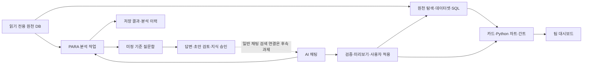

# Project Manager 중간 검토

검토일: 2026-10-23 · Asia/Seoul

후속 수정: 이 문서는 수정 전 발견 기록이다. 수정 내용과 이후 검증 결과는 [안정화 결과](midterm-repair-2026-10-23.md)에 정리했다.

핵심 기능은 실제 화면에서 연결되어 동작한다. 다만 **분석 조건의 정확성, 동시 편집 시 입력 보존, DB 설정과 일반 조회의 분리**를 먼저 보완해야 한다. 현재 판단은 내부 검증 지속 가능, 사내 운영 확대 전 안정화 필요다.

## 검토 범위와 확인 수준

- React 화면, FastAPI API, PostgreSQL 연결·버전 관리, 차트 캐시, Python 카드 실행, AI 채팅, PARA 분석, AI 지식·질문함, 시작 스크립트와 문서를 검토했다.
- 백엔드·프런트엔드·분석 영역을 병렬 검토하고 주요 발견을 교차 확인했다.
- 코드 경로만 확인한 항목과 순수 함수·모의 동시성으로 재현한 항목을 구분했다. 재현 가능하다는 것은 운영에서 이미 발생했다는 뜻은 아니다.
- 기존 앱을 기동해 전체 보드 6개 카드·간트, 데이터 관리, XXXA 프로젝트 범위(전체 18행 → 6행), PARA 카탈로그 17개 계열, 분석 이력 20건, 저장 결과 및 질문함 이동을 확인했다. 점검한 화면의 브라우저 오류·경고 로그는 없었다.
- 제품 소스와 저장된 카드·SQL·DB 접속 설정은 직접 수정하지 않았다. 테스트는 별도 임시 관리 DB와 읽기 전용 데모 원천을 사용했다. UI 조회 과정의 앱 자체 카탈로그 동기화는 정상 실행됐다.
- 외부 LLM 신규 요청, 실제 사내 SSO, 실서비스 부하·장시간 안정성·복구 훈련은 이번 검토에 포함하지 않았다.

## 기능 연결 상태

데이터셋·카드 작성과 분석 결과·질문함은 연결되어 있다. 승인된 지식을 일반 채팅에 자동 제공하는 연결은 아직 완성되지 않았다. `chat_tools.knowledge_context()`는 현재 관계 정보만 제공한다. 이는 문서상 후속 범위이므로 새로 발견한 회귀 오류로 집계하지 않았다.

## 우선 해결할 문제

### 1. P1 — AI가 추출한 날짜·재측정 방식과 사용자 요청의 일치를 검증하지 않음

**확인:** 실제 `prepare_request()` 순수 함수로 재현.

사용자가 `KST 2026-10-01 through 2026-10-03. Include all measurement events.`라고 요청해도, 모델이 다른 날짜(`2025-01-01`~`2025-02-01`)와 `latest_per_site`를 제시하면서 원문을 근거로 인용하면 통과한다. 재현에서 차단 조건은 비어 있었다.

현재 검사는 인용문 존재와 시간대 표기만 확인한다. 값과 근거의 의미가 맞는지 확인하지 않아 다른 기간·다른 표본으로 계산할 수 있다. 모델이 매번 잘못 해석한다는 뜻이 아니라, 잘못 해석했을 때 막을 장치가 부족하다는 뜻이다.

**조치:** 날짜·시간대와 정책을 정규화해 근거와 대조하고, 검증되지 않는 값은 기준 확인으로 돌린다. 실행할 조건과 근거를 수정 가능한 확인 화면에 표시하면 도움이 된다.

근거: [analytics/chat_tools.py:44](<C:/codex project/Project Manager/backend/app/analytics/chat_tools.py:44>).

### 2. P2 — 지원하는 UUID 컬럼이 카드에서는 응답 오류를 발생시킴

**확인:** 실제 `clean()` → `ChartPayload.from_result()` 호출로 UUID와 시간형 직렬화 오류 재현.

원천의 UUID는 지원 타입이며 차트의 범주·그룹으로 사용할 수 있다. 그러나 차트 캐시용 JSON 변환에서는 UUID가 문자열로 바뀌지 않아 오류가 난다. 표 조회의 기본 응답 변환과 차트 경로가 서로 다르다.

**조치:** 지원 DB 타입의 공통 JSON 변환을 정하고 표·차트·Python 입력에 적용한다. UUID뿐 아니라 time 등 같은 경계의 타입도 확인한다.

근거: [query.py:35](<C:/codex project/Project Manager/backend/app/query.py:35>), [chart_cache.py:19](<C:/codex project/Project Manager/backend/app/chart_cache.py:19>).

### 3. P2 — 새 DB 등록의 지연이 기존 DB의 조회까지 대기시킴

**확인:** 외부 연결을 스텁으로 바꾼 실제 저장 함수의 스레드 재현.

활성화하지 않는 DB를 등록하는 경우에도 전역 잠금을 잡고 연결 검사·카탈로그 탐색을 한다. 일반 API가 활성 DB를 확인할 때 같은 잠금을 기다리므로 새 DB의 느린 연결이 기존 보드·프로젝트 조회에도 영향을 준다. 재현에서 활성 DB는 바뀌지 않았지만 조회는 탐색 완료까지 기다렸다.

**조치:** 연결 검사와 후보 카탈로그 탐색을 잠금 밖으로 옮긴다. 최종 revision 확인·저장·활성 연결 교체 구간만 짧게 잠근다.

근거: [database_settings.py:127](<C:/codex project/Project Manager/backend/app/database_settings.py:127>), [database_settings.py:235](<C:/codex project/Project Manager/backend/app/database_settings.py:235>), [main.py:70](<C:/codex project/Project Manager/backend/app/main.py:70>).

### 4. P2 — 자동 갱신 후 차트의 실제 버전과 화면 버전이 달라짐

**확인:** 실제 갱신 설정(`chartQueryOptions`, `dashboardRefreshOptions`)과 QueryObserver에 모의 시간·응답을 사용해 재현.

다른 사용자가 데이터셋 v2를 저장한 뒤 자동 갱신하면 차트는 v2로 계산하지만, 보드 정의를 다시 읽지 않아 헤더에는 v1이 남을 수 있다. 재현 결과는 차트 결과 버전 2, 표시용 버전 1, 보드 조회 1회였다.

**조치:** 계산 응답의 `meta.dataset_version`을 표시하고 정의가 달라졌으면 메타데이터도 갱신한다. 편집 중인 배치와 카드 초안은 보존한다.

근거: [Dashboard.tsx:19](<C:/codex project/Project Manager/frontend/src/Dashboard.tsx:19>), [Dashboard.tsx:55](<C:/codex project/Project Manager/frontend/src/Dashboard.tsx:55>), [Charts.tsx:78](<C:/codex project/Project Manager/frontend/src/Charts.tsx:78>).

### 5. P2 — 프로젝트 질문함에서 분석 질문이 누락될 수 있음

**확인:** 실제 `question_visible()`로 재현하고 질문 생성 경로를 대조.

프로젝트 Inline과 공통 EPM을 함께 사용하는 분석 질문은 전체 질문함에는 나타나지만 프로젝트 필터에서는 사라질 수 있다. 프로젝트 필터로 데이터셋 목록을 먼저 줄인 뒤 그 목록을 원천 공개 여부 판단에도 사용하기 때문이다.

**조치:** 전체 공개 목록으로 접근 가능 여부를 확인하고, 질문의 프로젝트 태그로 화면 필터를 별도 적용한다.

근거: [collector_router.py:125](<C:/codex project/Project Manager/backend/app/semantic/collector_router.py:125>), [collector_service.py:60](<C:/codex project/Project Manager/backend/app/semantic/collector_service.py:60>).

### 6. P2 — 공동 검토 중 지식 초안의 미저장 편집이 사라질 수 있음

**확인:** 컴포넌트 생명주기와 서버 revision 증가 경로 확인. 두 브라우저 동시 편집 재현은 미실시.

검토 초안을 5초마다 조회하며 편집기 식별자에 revision을 포함한다. 다른 관리자가 같은 초안을 저장하면 편집기가 새로 생성되어 현재 작성 중인 본문과 검토 사유가 초기화된다. 서버의 저장 충돌 검사는 이미 사라진 로컬 입력을 복구하지 못한다.

**조치:** 초안 ID로 편집기를 유지한다. 미저장 변경이 있으면 외부 revision은 알림으로 보여주고 사용자가 비교·다시 불러오기를 선택하게 한다.

근거: [SemanticCollection.tsx:42](<C:/codex project/Project Manager/frontend/src/SemanticCollection.tsx:42>), [SemanticCollection.tsx:66](<C:/codex project/Project Manager/frontend/src/SemanticCollection.tsx:66>), [SemanticCollection.tsx:103](<C:/codex project/Project Manager/frontend/src/SemanticCollection.tsx:103>).

### 7. P2 — 분석 이력 조회가 표시하지 않을 큰 결과까지 읽음

**확인:** SQLAlchemy 조회 대상·모델 필드와 반복 호출 경로 확인. 대량 이력 부하는 미측정.

최근 100건을 조회할 때 전체 `result` JSON을 DB에서 가져온 뒤 응답에서만 버린다. 질문이 있는 각 분석마다 전체 데이터셋과 승인 지식도 다시 조회한다. 진행 중에는 목록을 2초마다 갱신한다. 결과당 20MB를 허용하므로 이력이 쌓일수록 실제 화면에 필요한 양보다 훨씬 많은 일을 할 수 있다. 현재 이력이 이 상한에 도달했다는 뜻은 아니다.

**조치:** 목록 조회에서 결과 본문을 제외하고 상세 화면에서만 가져온다. 원천·질문·지식 자료는 요청당 한 번 읽어 공유하고 목록에 페이지 이동을 제공한다.

근거: [analytics/router.py:24](<C:/codex project/Project Manager/backend/app/analytics/router.py:24>), [analytics/service.py:82](<C:/codex project/Project Manager/backend/app/analytics/service.py:82>), [AnalyticsWorkspace.tsx:46](<C:/codex project/Project Manager/frontend/src/AnalyticsWorkspace.tsx:46>).

### 8. P2 — 상태 확인 요청이 실패해도 ‘연결됨’이 남음

**확인:** 실제 QueryObserver와 현재 표시식으로 재현.

이전 성공 데이터는 조회 실패 뒤에도 남는다. 화면이 오류보다 이전 `connected` 값을 우선 사용하므로 네트워크 오류·401·503에서도 연결됨으로 보일 수 있다.

**조치:** ‘연결 상태 확인 실패’와 마지막 성공 시각을 표시한다. 이때 원천 DB 자체의 장애라고 단정하지 않는다.

근거: [App.tsx:94](<C:/codex project/Project Manager/frontend/src/App.tsx:94>), [DatabaseSettings.tsx:69](<C:/codex project/Project Manager/frontend/src/DatabaseSettings.tsx:69>).

### 9. P3 — DB 전환 후 이전 분석 결과 선택이 남음

**확인:** 상태 초기화와 결과 접근 검사 경로 확인.

A DB의 채팅에서 분석 결과를 연 다음 B DB로 전환하면 `analysisEntry`가 남아 A의 결과 ID를 B에서 요청하고 404를 표시한다. 서버는 다른 DB의 결과를 차단하므로 정보 유출 문제는 아니다.

**조치:** DB·계정 전환 시 선택을 초기화하거나 워크스페이스와 결과 ID를 함께 보관한다.

근거: [App.tsx:46](<C:/codex project/Project Manager/frontend/src/App.tsx:46>), [AnalyticsWorkspace.tsx:36](<C:/codex project/Project Manager/frontend/src/AnalyticsWorkspace.tsx:36>).

## 추가 확인이 필요한 경계

아래는 코드상 경로를 확인했으나 실제 부하·경쟁 상황을 재현하지 않은 항목이다.

- **큰 카탈로그에서 분석 채팅 차단:** 요청 종류를 분류하기 전에 전체 데이터셋을 모아 100,000자 한도를 검사한다. 선택한 데이터셋이 있어도 전체로 넓히므로 화면에서 범위를 줄이라는 안내를 따르기 어렵다. 먼저 최소 문맥으로 분류한 뒤 필요한 목록을 읽도록 분리한다. [assistant.py:114](<C:/codex project/Project Manager/backend/app/assistant.py:114>), [assistant.py:131](<C:/codex project/Project Manager/backend/app/assistant.py:131>).
- **새 보드 동시 첫 조회:** 보드 부재 확인과 INSERT가 분리되어 같은 ID 충돌 시 한 요청이 503으로 끝날 수 있다. 충돌 시 기존 보드를 다시 읽거나 삽입 충돌을 무해하게 처리한다. [main.py:154](<C:/codex project/Project Manager/backend/app/main.py:154>).
- **자동·수동 버전 생성의 경쟁:** 원천 스키마 탐색과 사용자 데이터셋 저장이 서로 다른 잠금 규칙을 사용한다. 같은 데이터셋의 다음 버전을 함께 만들 때 저장 실패 가능성을 별도 통합 테스트로 확인한다. [source_discovery.py:78](<C:/codex project/Project Manager/backend/app/source_discovery.py:78>), [main.py:356](<C:/codex project/Project Manager/backend/app/main.py:356>).

## 효율성 평가

차트 캐시는 60초 이하 TTL, 용량·건수 제한, 동일 요청 합치기, 이미 처리 중이던 요청이 캐시 초기화 뒤 결과를 다시 넣지 못하게 하는 처리가 있어 기본 구조가 좋다. SQL은 원천에서 집계하고, Python 카드는 서버 커서·임시 파일·격리 프로세스를 사용한다.

기존 10월 21일 성능 기록에는 동일 조건 30명 동시 조회에서 보드 P95가 캐시 재사용 시 1.544초, 캐시 초기화 시 1.711초였고 개선 후 1,575요청이 성공했다고 되어 있다. **이번에 다시 측정한 수치는 아니며 현재 모든 카드·다른 필터 조합의 성능을 보증하지 않는다.** [기존 성능 보고서](<C:/codex project/Project Manager/validation/dashboard-performance-report.md>).

앞으로는 분석 목록의 불필요한 결과 로딩을 먼저 줄이고, 그 다음 매 요청 전체 원천·관계·데이터셋 이력을 읽는 경로를 현재 DB와 참조 항목으로 좁히는 것이 효과적이다. 연결 풀이나 worker 수를 먼저 늘릴 근거는 아직 없다.

빌드 결과는 앱 JS 약 1.01MB, Cartesian Plotly 약 1.43MB, 전체 Plotly 약 4.84MB였다(압축 전). Plotly는 지연 로딩이므로 이를 모두 초기 다운로드 크기로 합산하면 안 된다. 큰 묶음 경고가 있으며 기능별 화면 분할과 실제 로딩·그리기 시간 측정은 후속 최적화 대상이다.

## 잘 갖춰진 점과 운영 전 조건

- 읽기 전용 원천 계정 검증과 읽기 전용 트랜잭션, SQL 허용 목록을 함께 적용한다.
- 활성 DB와 식별자를 요청별로 묶고, 전환 revision을 캐시 경계에 포함한다.
- 저장 권한 확인, 마지막 관리자 보호, 카드 저장 충돌, AI 제안의 원자적 적용·중복 적용 방지가 있다.
- Python 카드에 문법 제한·별도 실행 프로세스·시간과 메모리 제한이 있다.
- 분석 결과와 승인 지식이 분리되어 있고, 결과를 읽을 때 원천 공개 범위를 다시 검사한다.

사내 SSO 어댑터는 아직 미구현이며 문서에 이미 명시되어 있다. 쿠키 이름만 설정해도 실사용 인증이 되는 상태는 아니다. 현재 모든 사용자에게 모든 프로젝트가 보이는 것도 명시된 설계다. 사내 배포 전에 SSO 계약 연결, 필요 시 프로젝트 접근 정책, HTTPS, 백업·암호화 키 복구 절차를 검증해야 한다.

현재 작업 폴더에서 Git 저장소와 CI 설정, 자동 백업·복구 실행 도구를 확인하지 못했다. 외부에서 별도로 관리되는지는 이번 근거에 포함되지 않는다. 중간 검토 시점의 소스·관리 DB·암호화 키 복구 지점을 확보하고, 테스트·빌드·복구 점검을 반복 가능한 절차로 묶는 것이 필요하다.

README/CONTRACT의 카드 버전 고정·heatmap·Seaborn 설명 일부는 현재 구현과 다르다. 현재 최신 버전 추종은 전용 테스트로 명시되어 있어 그 자체를 회귀로 판정하지 않았다. 기능 변경에 맞춰 설명서와 계약 문서를 함께 정리해야 한다.

## 추가 기능 제안과 순서

| 순서 | 기능 | 사용자에게 주는 효과 | 완료 기준 |
|---|---|---|---|
| 1 | 분석 조건·근거 확인 | 다른 기간·정책으로 계산하는 실수를 줄임 | 기간·시간대·프로젝트·재측정 방식과 출처를 보여주고 수정 가능 |
| 2 | 데이터셋 변경 영향 미리보기·복구 | SQL 수정으로 기존 카드가 깨지는 것을 사전에 확인 | 영향 카드 목록, 사라지는 컬럼, 변경 전후 값 비교, 이전 정의로 되돌리기 |
| 3 | 편집 초안 복구·충돌 비교 | SQL·카드·지식 편집 중 작성 내용 보존 | 외부 저장·화면 전환 후 입력 복구와 충돌 비교 |
| 4 | 분석 → 질문 → 승인 근거 바로가기 | 질문함에서 같은 항목을 다시 찾는 일을 줄임 | 정확한 질문 ID·지식 버전으로 이동하고 분석 조건에 재적용 |
| 5 | 승인 지식의 채팅 연결 | 사용자 정의·업무 기준을 채팅이 재사용 | 승인 버전·근거 표시, 상충 정의 감지, 미정 조건은 질문 연결 |
| 6 | 작업·데이터 상태 화면 | 느린 조회·실패·오래된 데이터의 원인 파악 | 대기·진행·실패·재시도·취소, 마지막 수집·조회 시각, 실행 소요 시간 표시 |

작은 사용성 개선으로 공통 데이터셋과 프로젝트 전용 데이터셋에 구분 배지를 붙일 가치가 있다. 실제 XXXA 데이터 관리에서 같은 이름·원천을 가진 데이터셋 쌍들이 함께 표시되어 선택 시 구분이 어렵다.

추천 실행 순서는 **분석 조건 검증 → 지원 타입 직렬화·편집 보존 → DB 잠금·화면 상태 동기화 → 이력 조회 최적화 → 지식 활용 확장**이다.

## 검증 기록

- 프런트엔드 자동 검사: **96개 통과**, 실패·건너뜀 없음.
- TypeScript 검사와 별도 디렉터리 프로덕션 빌드: **성공**. 기존 서비스 산출물과 새 빌드의 JS·CSS 해시 이름 일치.
- FAB 생성기·일정 검사: **5개 통과**.
- 백엔드 전체·기본 데모 검사: **879개 통과, 1개 실패, 1개 건너뜀**, 425.60초. 별도 임시 관리 DB를 사용했고 종료 후 해당 DB를 정리했다.
- 실제 UI 조회: 전체 보드 6카드, 데이터 관리, 프로젝트 범위, 분석 카탈로그·이력·저장 결과, 질문함 이동 정상.
- 별도 결함 재현: 날짜·정책 근거 불일치, UUID·시간형 직렬화, DB 등록 잠금, 카드 버전 표시, 질문 프로젝트 필터, 연결 상태 표시.

실패한 검사는 `test_additive_migration_is_idempotent`다. 현재 마이그레이션은 `[1, 2, 3, 4, 5]`를 기록하지만 테스트가 `[1, 2, 3, 4]`만 기대한다. 5단계는 분석 질문의 원천 범위 정보를 위한 현재 구현에 존재한다. 따라서 이번 실패는 최신 구현과 테스트 기대값의 불일치이며, 마이그레이션 실행 자체의 실패로 판정하지 않는다. [테스트:102](<C:/codex project/Project Manager/backend/tests/test_semantic.py:102>), [마이그레이션:27](<C:/codex project/Project Manager/backend/app/semantic/migration.py:27>).

검토 단계에서는 이 테스트나 제품 소스를 수정하지 않았다. 후속 안정화 작업에서 기대 버전 갱신과 반복 실행 후 데이터 보존 검증을 함께 정리해야 한다. 전체 검사 원본은 [검증 로그](<C:/codex project/Project Manager/.local/midterm-backend-tests.log>)에 있다.

기존 자동 검사가 통과하더라도 위 경계에 결함이 없음을 보장하지 않는다. 안정화 단계에서는 발견한 조건을 회귀 검사로 추가해야 한다.
